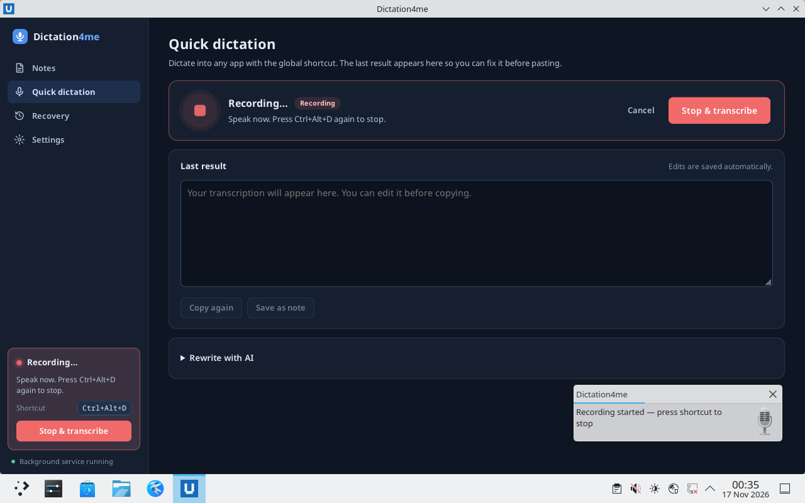

# Dictation4me

**System-wide voice dictation and AI-assisted notes for KDE Plasma (Wayland) and Windows.** Press a global shortcut in any app, speak, press again, and the transcript is ready to paste. A native notebook keeps voice notes, lets you rewrite text with your own AI instructions, and never changes your text without asking.

You choose the speech-to-text and AI servers (any OpenAI-compatible endpoint, local or remote). Notes stay in a local SQLite database. No browser, no JavaScript, no cloud account.


| Live window while dictating | Quick dictation | Settings |
|---|---|---|
|  |  |  |

## Features

- **Two-press dictation:** press the shortcut to record, press again to stop. The text is typed into the app you are in (or copied, or held for review: your choice in Settings › Dictation). On KDE Wayland pasting uses the desktop's Remote Control permission, approved once; nothing privileged is installed.
- **Live transcription (optional):** with a realtime model (e.g. Voxtral via vLLM/LiteLLM `/v1/realtime`) a small window shows your words as you speak and closes before the text is pasted. The recording is still saved, and the normal model takes over if the stream fails.
- **Tray icon:** a microphone in the system tray turns into a red dot while recording; click it to open the notebook, right-click for Start/Stop and Quit.
- **Always-visible status:** the sidebar shows what dictation is doing (Ready, Recording, Transcribing, Text ready, Needs attention) on every screen, alongside desktop notifications.
- **Notebook:** folders, tags, pins, archive and trash, Markdown with preview, autosave, and a full version history (restoring creates a new version).
- **Voice notes:** record straight into a note. If you kept typing meanwhile, your typing wins and the transcript waits under *Recordings* to be added.
- **AI rewrite:** eight built-in instructions plus your own presets. Results are proposals: *Replace note*, *Keep as version*, *New note* or *Discard*.
- **Nothing is lost:** failed or silent recordings stay in **Recovery** until you retry or discard them.
- **Errors tell you how to fix them:** every message in the app, notifications and CLI comes with a concrete fix (package to install, setting to change, log to read); `dictation4me doctor` lists problems with fixes.
- **Private by design:** keys come from an environment variable or the OS keyring (never the config file); remote servers need explicit approval; TLS checks cannot be disabled.

## Install

Requirements: Python 3.12+, [uv](https://docs.astral.sh/uv/), and on Linux glibc 2.39+ (NativeHTMLKit).

**Linux system packages** (Debian/Ubuntu names):

```sh
sudo apt install libportaudio2 pipewire-alsa wl-clipboard
```

`libportaudio2` is required for the microphone. `pipewire-alsa` lets PortAudio record through PipeWire; without it, raw ALSA devices often refuse 16 kHz. `wl-clipboard` is needed for clipboard delivery on Wayland. On X11, install `xclip` instead.

**Install and register the app:**

```sh
uv tool install .            # or: uv sync && uv run dictation4me …
dictation4me init --autostart
dictation4me gui
```

`init` writes default settings and installs the desktop entry. The desktop entry is **required for the KDE global shortcut**: the shortcut portal only accepts registered apps. `--autostart` starts the background service at login (not the window).

## First run

1. Open **Settings › Connections** and enter the server URL and model for *Speech-to-text* and *AI writing*. Home-network names like `http://pgx:4000/v1` are fine over plain HTTP; internet servers need HTTPS and the "Allow sending… to remote servers" checkbox.
2. Choose how the API key is provided:
   - **System keyring** (recommended): paste the key into "Paste a new key" and save.
   - **Environment variable:** works when the service inherits it, e.g. when started from a terminal. A service started at login does **not** see variables from `~/.bashrc`. The card shows whether the key is available, and **Move key to keyring** fixes it in one click.
3. Use **Test connection** / **Test with a WAV file…** to check each server.
4. Approve the shortcut in the KDE dialog that appears the first time (default `Ctrl+Alt+D`).
5. For two-press dictation, choose **Settings › Dictation › Shortcut behaviour: type the text into the active app** and click **Allow automatic pasting…** once (approve the KDE "Remote Control" dialog with "Allow restoring" ticked).
6. Optional live text: **Settings › Connections › Transcription mode: Live**, and enter the realtime model (for LiteLLM + vLLM Voxtral: `asr-realtime`).

### About the global shortcut on KDE

The preferred shortcut in Settings is offered to KDE when the app first registers. After that, **KDE owns the key**. Change it in *System Settings › Keyboard › Shortcuts › Dictation4me*. Settings › Dictation shows the key that is actually active and warns when it differs. Avoid keys KDE already uses (for example `Meta+L` locks the screen). If the portal is unavailable, bind a custom KDE shortcut to `dictation4me toggle`.

## Daily use

| Action | Result |
|---|---|
| Shortcut, first press | Start recording (tray dot and sidebar turn red; live window in live mode) |
| Shortcut, second press | Stop, transcribe and type the text into the active app (or copy, per setting) |
| Shortcut when *Text ready* (review mode only) | Copy to clipboard; paste with `Ctrl+V` |
| Next press | Start a new recording |
| `Ctrl+N` / `Ctrl+S` / `Ctrl+K` in the window | New note / save a version (or save settings) / search |

The text always goes to the clipboard first, then the paste keys are sent once to the focused window; whether the app accepted them cannot be verified. For terminals choose `Ctrl+Shift+V` as paste keys. The live window takes keyboard focus while you speak and is closed before pasting so focus returns to your app.

## Command line

```sh
dictation4me gui | quick-review           # open the notebook (or its Quick tab)
dictation4me service start|stop|status|restart
dictation4me toggle | cancel              # same as the shortcut / cancel a capture
dictation4me copy-last | paste-last       # paste-last may duplicate text
dictation4me doctor --json                # dependency and configuration check
dictation4me devices
dictation4me recover list|retry|salvage|delete [ID]
dictation4me test microphone|stt --file x.wav|ai|clipboard
dictation4me backup --output backup.zip
dictation4me export --output notes.zip
dictation4me restore --input backup.zip --destination ./new-profile
dictation4me uninstall [--purge --confirm-purge]
```

`restore` always writes to a new, empty folder; run with `DICTATION4ME_HOME=<folder>` to use it. Backups are unencrypted ZIP files. `uninstall` removes launchers and keeps your notes unless `--purge --confirm-purge` is given.

## Architecture

```text
 NativeHTMLKit notebook (HTML/CSS, Python callbacks) ─┐
 CLI / desktop shortcut command ──────────────────────┤ authenticated loopback JSON-RPC
                                                      ▼
            Resident service (own systemd user unit on Linux)
            recorder · state machine · jobs · shortcut/clipboard adapters
                 │                         │
           SQLite + WAV spool       OpenAI-compatible STT and chat servers
```

The service keeps running when the window closes. Key modules: `engine.py` (controller), `storage.py` (SQLite), `audio.py` (PCM16 WAV spool), `providers.py` (bounded HTTP clients), `desktop/` (KDE portal, X11, Win32 adapters), `gui.py` + `assets/` (notebook). Design specifications are in [`design-spec/`](design-spec/), the UX rationale in [`docs/UX_REVIEW.md`](docs/UX_REVIEW.md), and the qualification evidence in [`qualification/`](qualification/).

## Development

```sh
uv sync --group dev
uv run ruff check src tests
uv run pytest -q
uv build
```

Tests use isolated `DICTATION4ME_HOME` profiles and never register real global shortcuts (`DICTATION4ME_NO_HOTKEY`). Native behaviour (microphone, portal shortcut, focus and paste) must be checked on a real desktop; see [`docs/IMPLEMENTATION_STATUS.md`](docs/IMPLEMENTATION_STATUS.md).

## Status and limitations

Qualified on KDE Plasma 6 Wayland (Debian 13 and Ubuntu 26.04) with real microphone, portal shortcut, clipboard and OpenAI-compatible servers. **Windows x64 has not been qualified yet.** There is no macOS support, no tray icon on Windows yet (Linux has one), no rich-text editor (Markdown source plus preview), and no live streaming transcription.

License: MIT.
