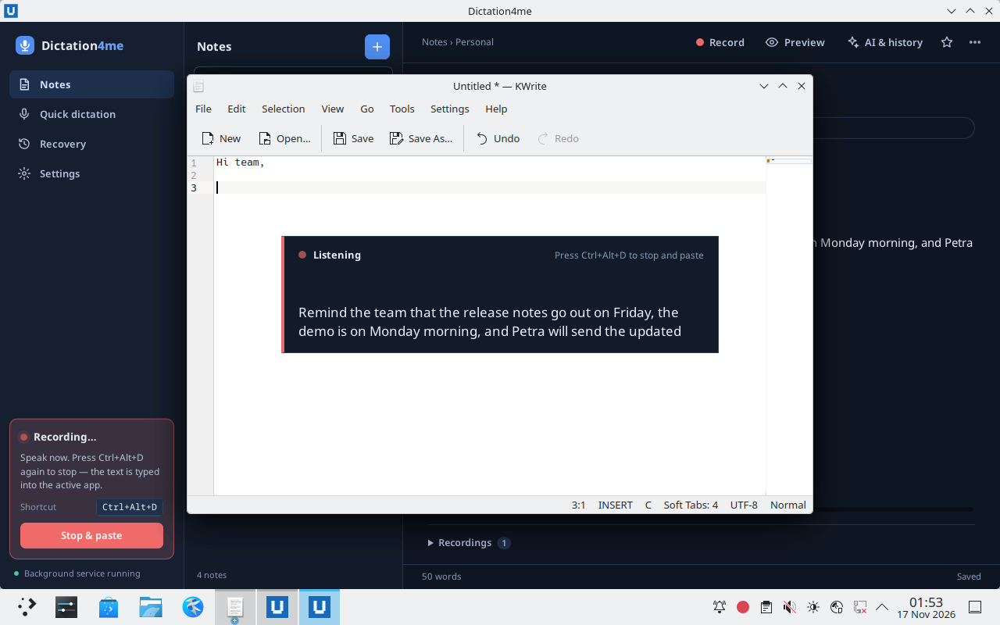
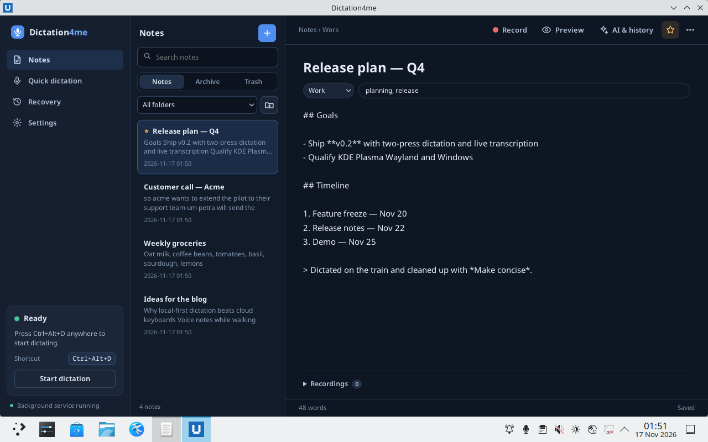
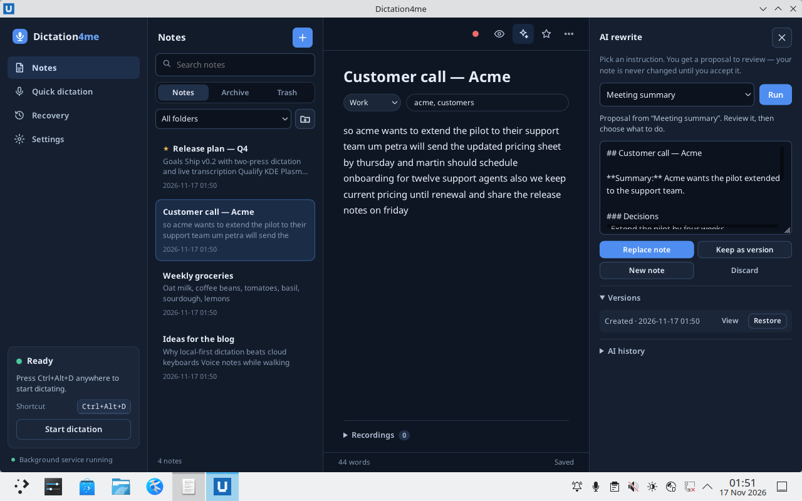
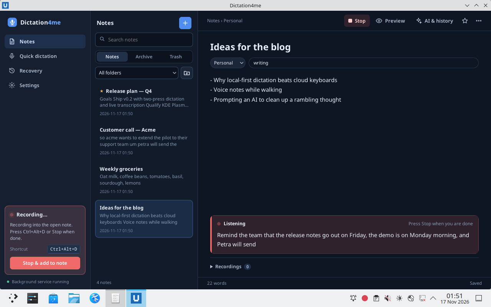
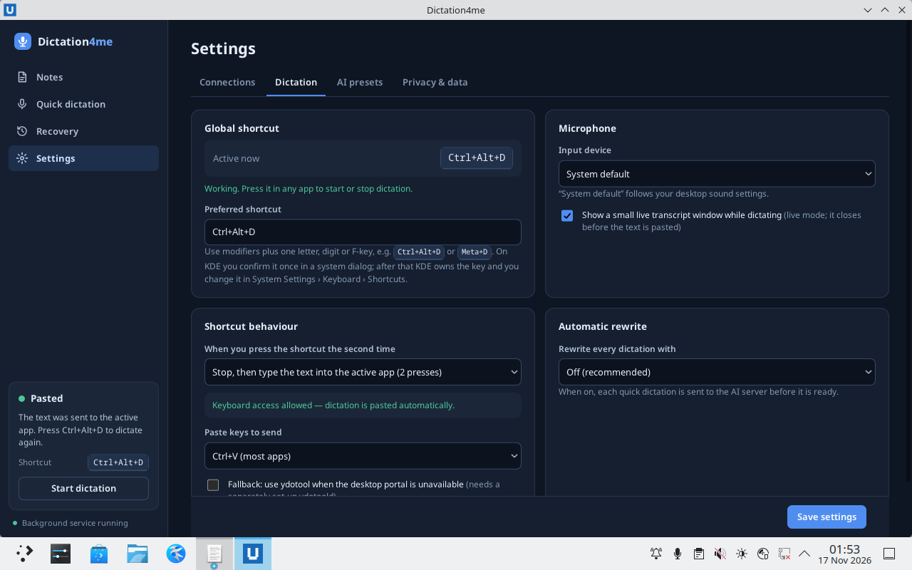

<h1 align="center">Dictation4me</h1>

<p align="center"><b>Press a shortcut, speak, press again — your words are typed into any app.</b><br>
Live transcription, AI-assisted voice notes and a native notebook for KDE Plasma (Wayland).<br>
Your own speech and AI servers. Your notes stay on your computer.</p>

<p align="center">
<a href="https://github.com/bigbatmanorg/dictation4me/releases/latest"></a>
<a href="https://github.com/bigbatmanorg/dictation4me/actions"></a>


</p>



## Features

- 🎙️ **Two-press dictation anywhere.** Press **Ctrl+Alt+D**, speak, press again. The text is typed where your cursor is (or copied, if you prefer). It uses KDE's own permission system; nothing privileged is installed.
- ⚡ **Live transcription.** With a realtime model (e.g. Voxtral on vLLM) a small window shows your words as you speak. The recording is always saved, and the normal model takes over if the live stream fails.
- 📝 **Voice notes.** Record into a note and watch the words appear inside it.
- ✨ **AI rewrite with review.** Turn a rambling call transcript into a meeting summary, a polite email or a task list. You get a proposal and choose *Replace*, *Keep as version* or *New note*; every change is versioned.
- 🔌 **Bring your own servers.** Any OpenAI-compatible endpoint (LiteLLM, vLLM, LocalAI, OpenAI). Speech and AI are configured separately; keys live in the OS keyring.
- 🛟 **Nothing gets lost.** Failed recordings wait in Recovery with a "how to fix" hint. Errors everywhere tell you what to do, and `dictation4me doctor` checks your setup.
- 🧭 **Tray icon** with recording state, plus a background service that keeps working when the window is closed.

| Notes | AI rewrite proposal |
|---|---|
|  |  |
| **Voice note with live text** | **Settings** |
|  |  |

## Install

**1. System packages** (Linux, once):

```sh
sudo apt install libportaudio2 pipewire-alsa wl-clipboard      # Debian/Ubuntu
sudo dnf install portaudio pipewire-alsa wl-clipboard          # Fedora
```

**2. Install with [uv](https://docs.astral.sh/uv/) straight from GitHub:**

```sh
# latest release
uv tool install git+https://github.com/bigbatmanorg/dictation4me@v0.2.0

# or the release wheel
uv tool install https://github.com/bigbatmanorg/dictation4me/releases/download/v0.2.0/dictation4me-0.2.0-py3-none-any.whl

# or the development version (main branch)
uv tool install git+https://github.com/bigbatmanorg/dictation4me
```

**3. Register the app** (menu entry, autostart, and what KDE needs for the shortcut):

```sh
dictation4me init --autostart
dictation4me gui
```

Requirements: Python 3.12+, glibc 2.39+ (Ubuntu 24.04+, Debian 13+, Fedora 40+), KDE Plasma 6 on Wayland recommended. If `dictation4me` is not found after installing, run `uv tool update-shell` and open a new terminal.

## Set up in two minutes

1. **Settings › Connections:** enter your speech-to-text server URL and model (e.g. `http://my-server:4000/v1`, `whisper-1`). For live text choose *Transcription mode: Live* and a realtime model (e.g. `asr-realtime`). Add the AI server if you want rewrites. Paste the API key; it is stored in the system keyring.
2. Approve the shortcut in the KDE dialog (default **Ctrl+Alt+D**).
3. **Settings › Dictation › Shortcut behaviour:** *type the text into the active app*, then click **Allow automatic pasting…** and approve once.
4. Click into any text field, press **Ctrl+Alt+D**, speak, press **Ctrl+Alt+D**.

Running LiteLLM + vLLM? There's a ready-made config in the [user guide appendix](docs/USER_GUIDE.md#appendix-litellm--vllm-server-example).

## Documentation

- 📖 **[User guide](docs/USER_GUIDE.md):** install, setup, daily use, every setting, CLI, privacy, troubleshooting
- 🧩 [Architecture](docs/ARCHITECTURE_IMPLEMENTED.md) · [UX review](docs/UX_REVIEW.md) · [Design specifications](design-spec/)
- ✅ [Implementation status](docs/IMPLEMENTATION_STATUS.md) and [qualification evidence](qualification/runs/)
- 📝 [Changelog](CHANGELOG.md)

## Quick reference

| | |
|---|---|
| Dictate into any app | **Ctrl+Alt+D**, speak, **Ctrl+Alt+D** |
| Open the notebook | app menu, tray icon, or `dictation4me gui` |
| New note / save version / search | **Ctrl+N** / **Ctrl+S** / **Ctrl+K** |
| Something wrong? | `dictation4me doctor` |
| Shortcut from a script / custom key | `dictation4me toggle` |
| Back up | `dictation4me backup --output notes.zip` |

## Platform status

| | KDE Plasma 6 Wayland | Other Linux desktops / X11 | Windows 10/11 |
|---|---|---|---|
| Notebook, notes, AI, Recovery | ✅ verified | ✅ expected | ⚠️ tests pass, not yet verified on a desktop |
| Global shortcut | ✅ desktop portal | X11 key grab / `dictation4me toggle` | ⚠️ RegisterHotKey, not verified |
| Typing into the active app | ✅ Remote Control portal | X11: xdotool | ⚠️ SendInput, not verified |
| Live transcription + live window | ✅ | ✅ expected | ⚠️ untested |
| Tray icon | ✅ | ✅ (StatusNotifierItem) | ❌ not yet |

Not included: macOS, cloud sync, rich-text editing (Markdown with preview instead).

## Development

```sh
git clone https://github.com/bigbatmanorg/dictation4me && cd dictation4me
uv sync --group dev
uv run ruff check src tests && uv run pytest -q
uv run dictation4me gui
```

Tests use isolated profiles (`DICTATION4ME_HOME`) and never touch your real shortcut, tray or keyring. Real-desktop behaviour is verified separately and recorded under [`qualification/runs/`](qualification/runs/).

## License

MIT. See [LICENSE](LICENSE).
