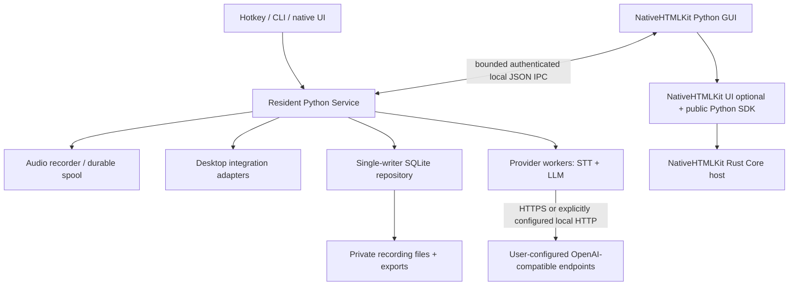

# Architecture and repository structure

## Architecture overview



**Exactly one resident Python process owns state, I/O orchestration, shortcuts and database writes.** One on-demand GUI process controls a NativeHTMLKit Core host through the public SDK; GUI process is disposable. The GUI does not open its own database writer. `dictation4me` CLI commands are small local IPC clients. No HTTP listener or REST API.

## Why service separate from NativeHTMLKit

Current SDK's `Application.start()` re-executes application logic in the host-launched backend (side effects before it run twice); `app.ready()` requires an opened window, closing the last window ends the app, and Wayland rejects hidden initial windows and visibility/focus changes. A daemon must **not** try to keep a phantom Core window alive or hook private host protocols. Run native service as ordinary user process, completely independent of Core lifecycle. GUI launched on demand via its own entrypoint, initializes NativeHTMLKit only after process separation. No OS-wide privileged service.

## Process model

1. `dictation4me service start` ensures per-user single instance; initialization verifies directory permissions, DB migrations and journals, then registers hotkey/tray/notifications.
2. `dictation4me gui` pings service and starts it if absent, then enters `Application.start(name=..., app_id=...)` **after CLI/daemon side effects have been guarded**. GUI subscribes/polls service state via IPC and mounts one main window.
3. GUI window close ends only GUI process/Core host. Resident service continues unless user explicitly chooses Quit Service.
4. On logout, OS stops per-user service; in-progress audio spool preserved and recovered on next login.
5. `dictation4me service stop` stops accepting new operations, finalizes or marks capture interrupted, commits DB, cleans private IPC files, releases shortcuts and exits. UI shows disconnected but stays if possible.

## Application layers (no plugin platform)

| Layer | Responsibilities | Depends on |
|---|---|---|
| `domain` | data types, states, invariants, version rules, pure transformations | stdlib only |
| `storage` | DB migrations, transactions, FTS, recovery and media path ownership | domain + sqlite3/filesystem |
| `audio` | microphone selection, streaming spool, PCM/WAV conversion, playback | domain + sounddevice + numpy/soxr if verified |
| `providers` | HTTP speech/LLM clients, request profiles, timeout/response parsing | domain + httpx |
| `desktop` | OS keyboard shortcuts, paste, clipboard, notifications, tray/autostart | domain + OS adapters |
| `service` | serialized controller, jobs, IPC dispatcher, worker executor, startup | all service components |
| `ui` | NativeHTMLKit view, event handlers, state projection, editor, settings | service API + public NativeHTMLKit SDK/UI |
| `cli` | client commands, init/doctor/backup/export | service API; a few offline installation actions |

No `domain` module may import NativeHTMLKit. The UI library must never import Core internals, protocol, or CLI; application may use public SDK beside UI library. No general event bus/plugin loader/config framework.

## Suggested source tree

```
pyproject.toml                     # uv, deps, entry points
src/dictation4me/
  __init__.py  __main__.py  cli.py  paths.py  config.py
  domain/{models.py,states.py,commands.py,errors.py}
  storage/{db.py,migrations.py,notes.py,media.py,recovery.py,search.py}
  audio/{recorder.py,conversion.py,playback.py}
  providers/{stt.py,llm.py,models.py}
  desktop/{base.py,linux.py,windows.py,notifications.py}
  service/{main.py,controller.py,jobs.py,ipc.py}
  ui/{main.py,notebook.py,editor.py,ai_panel.py,settings.py,assets/}
tests/{unit,integration,contract,desktop}
qualification/{acceptance.csv,linux,windows}
docs/ ... spec/ ... agent/ ...
```

The layout is a target, not a license to create dozens of empty abstractions. Keep implementation minimal and refactor only when code demonstrates duplication.

## IPC contract

- Bounded length-prefixed **UTF-8 JSON** over **127.0.0.1** loopback TCP on an OS-assigned port; no HTTP. A random per-user token stored only in private runtime config/auth file authenticates requests. Enforce private mode (0600 files/0700 dirs on Linux; user-restricted DACL on Windows), size ceiling (1 MiB per message; chunking/paging for large results) and strict max concurrent clients/rate limits.
- A private endpoint discovery file stores only PID, port, protocol version and token file *path*, never token inline in public launcher arguments/logs. Stale endpoint cleanup only after checking PID and successful lock acquisition.
- All requests `{id,version,command,params,auth}`; replies `{id,ok,result|error}`; subscribe to state changes by versioned poll or bounded long-poll, **not** a separate web server. Poll initial v1 to simplify. No arbitrary shell/code evaluation, direct SQL, filesystem paths or user-entered command execution on IPC.
- Service is owner of mutable state; `idempotency_key` required for mutating commands, compare-and-swap `edit_seq` on draft updates. Reject wrong protocol version, unknown command, oversize payload, auth failure, invalid note ID, stale job generation, and second active capture.
- IPC token is permission boundary against other users/processes, but not protection against malicious code running under the same user account. Do not claim stronger isolation.
- `spec/schemas/ipc.schema.json` specifies message envelopes. Define command schemas explicitly in code and test contract table below.

### Essential commands

| Command | Input | Output |
|---|---|---|
| `health` | none | version, state, capabilities, queue counts (no sensitive content) |
| `capture.toggle` | mode=`quick|note`, optional note_id | state + capture_id |
| `capture.cancel` | capture_id | cancelled, recovery_id if any |
| `capture.retry` | recovery_id | queued job ID |
| `quick.get` | optional capture_id | text/state (authenticated) |
| `quick.deliver` | capture_id, mode=copy|paste | attempt status, clipboard fingerprint |
| `notes.list` | page, filter/search | lightweight summaries + total |
| `notes.get` | note_id | note + selected revision + draft + metadata |
| `notes.create` | title/folder optional | note_id + edit_seq |
| `notes.save_draft` | note_id, expected_edit_seq, content | committed edit_seq, saved_at |
| `notes.checkpoint` | note_id | accepted revision ID |
| `notes.move_to_trash` | note_id | status |
| `ai.propose` | source note/range, preset_id, source_hash | job ID |
| `ai.accept` | proposal_id, action, expected_edit_seq | revision ID / conflict |
| `jobs.get` | job_id | job status/errors without key |
| `settings.get/update` | redacted settings or validated patch | active effective settings |

All list endpoints must paginate, sanitize error messages and bound text length. Audio bytes never flow through general IPC: service owns files. UI playback requests reference recording IDs, not arbitrary user filesystem paths.

## Concurrency

- **Controller:** one serialized event/command queue; each transition atomic under an async lock or single actor. Fast operations only; no network/PortAudio inside lock.
- **Audio:** callback appends bounded PCM chunks to spool worker. Never block PortAudio callback on DB/network/GUI. Propagate overflow/error with explicit status.
- **Providers:** bounded `asyncio` tasks or thread pool, cancellable by generation, one active microphone capture globally, one capture STT and bounded AI concurrency (default 2). Job and data state commit via repository owner only.
- **DB:** one writer queue; WAL, busy timeout, foreign keys and transactions. Never hold transaction during HTTP request.
- **UI:** UI worker callbacks map responses to UI owner thread; use public SDK thread contract and `ui.post(...)` for UI library state. Avoid known concurrent `Computed` race by serializing related mutations.
- **Shutdown:** stop accepting commands; wait bounded for audio flush and DB commit; cancel HTTP safely; do not claim cancellation can undo remote processing/paste.

## Error families

`MIC_PERMISSION`, `MIC_DEVICE`, `AUDIO_OVERFLOW`, `DISK_FULL`, `AUTH_UNAVAILABLE`, `STT_UNAVAILABLE`, `STT_INVALID_RESPONSE`, `LLM_UNAVAILABLE`, `LLM_INVALID_RESPONSE`, `SOURCE_CHANGED`, `CLIPBOARD_UNAVAILABLE`, `PASTE_UNSUPPORTED`, `PASTE_UNCERTAIN`, `SHORTCUT_CONFLICT`, `IPC_UNAVAILABLE`, `DB_CORRUPT`, `FTS_UNAVAILABLE`, `PLATFORM_UNSUPPORTED`. Each has a user-facing action and sanitized machine-readable code; HTTP response bodies must not be logged verbatim.
