# Dictation4me user guide

Dictation4me lets you dictate into any application with a global shortcut and keeps AI-assisted voice notes in a native notebook. Speech-to-text and AI run on servers **you** choose: any OpenAI-compatible endpoint, such as LiteLLM, vLLM, LocalAI, or OpenAI itself. Notes stay on your computer.

- [1. How it fits together](#1-how-it-fits-together)
- [2. Install](#2-install)
- [3. First-time setup](#3-first-time-setup)
- [4. Dictating into any app](#4-dictating-into-any-app)
- [5. The notebook](#5-the-notebook)
- [6. Recovery](#6-recovery)
- [7. Settings reference](#7-settings-reference)
- [8. Command line](#8-command-line)
- [9. Privacy and your data](#9-privacy-and-your-data)
- [10. Troubleshooting](#10-troubleshooting)
- [11. Updating and uninstalling](#11-updating-and-uninstalling)
- [Appendix: LiteLLM + vLLM server example](#appendix-litellm--vllm-server-example)

---

## 1. How it fits together

| Part | What it does |
|---|---|
| **Background service** | Owns the microphone, the global shortcut, the notes database and all server requests. It keeps running when you close the window, starts at login if you choose, and shows a **tray icon**. |
| **Notebook window** | Notes, quick-dictation history, Recovery and Settings. Open it from the app menu, the tray icon or `dictation4me gui`. |
| **Live window** | A small window that shows your words while you dictate (live mode only). |
| **Command line** | `dictation4me …` for setup, diagnostics, backups and scripting. |

The service is the single source of truth. The window and CLI talk to it over an authenticated local connection; nothing listens on the network.

## 2. Install

### Requirements

- **Linux:** KDE Plasma 6 on Wayland is the primary target (X11 works with reduced features). glibc 2.39 or newer (Ubuntu 24.04+, Debian 13+, Fedora 40+).
- **Windows:** experimental. The automated test suite passes on Windows x64, but the app has not yet been verified on a real Windows desktop, and there is no tray icon or live window there.
- Python 3.12+ and [uv](https://docs.astral.sh/uv/getting-started/installation/).
- A microphone, and an OpenAI-compatible speech-to-text server (an AI server is optional).

### System packages (Linux)

```sh
# Debian / Ubuntu
sudo apt install libportaudio2 pipewire-alsa wl-clipboard
# Fedora
sudo dnf install portaudio pipewire-alsa wl-clipboard
```

| Package | Why |
|---|---|
| `libportaudio2` / `portaudio` | Microphone access. Without it recording fails with "PortAudio is unavailable". |
| `pipewire-alsa` | Lets PortAudio record through PipeWire. Without it raw devices often reject 16 kHz and recording fails or drops audio. |
| `wl-clipboard` | Clipboard on Wayland (`xclip` on X11). |

### Install from PyPI (recommended)

```sh
uv tool install dictation4me
```

`uv tool install` creates an isolated environment and puts `dictation4me` on your `PATH` (usually `~/.local/bin`). If the command isn't found, run `uv tool update-shell` and open a new terminal.

Other options:

```sh
uv tool install dictation4me==0.3.0                                        # a specific version
uv tool install git+https://github.com/bigbatmanorg/dictation4me@v0.3.0    # a GitHub release tag
uv tool install git+https://github.com/bigbatmanorg/dictation4me           # latest main branch
pipx install dictation4me                                                  # pipx instead of uv
```

### Register the app

```sh
dictation4me init --autostart
```

This creates your settings file, the application-menu entry and (with `--autostart`) a login entry for the background service. **The menu entry is required on KDE:** the desktop only grants the global shortcut and automatic pasting to registered apps.

### From source (development)

```sh
git clone https://github.com/bigbatmanorg/dictation4me
cd dictation4me
uv sync --group dev
uv run dictation4me init --autostart
uv run dictation4me gui
```

## 3. First-time setup

Open **Dictation4me** from the application menu (or run `dictation4me gui`), then open the **Settings** tab. Settings is one page; the tree on the left jumps to each section.

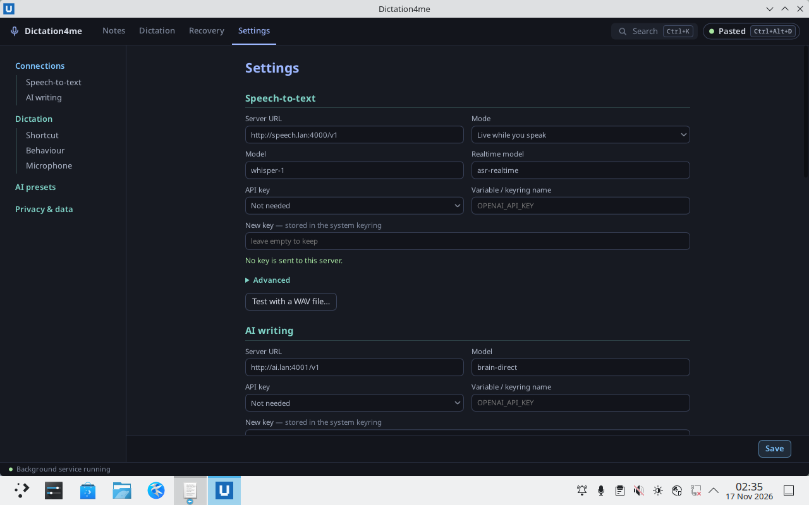

### 3.1 Connect your servers (Settings › Connections)

**Speech-to-text**

| Field | What to enter |
|---|---|
| Server URL | The OpenAI-compatible base URL, e.g. `http://my-server:4000/v1`. Plain `http://` works for home-network names (`pgx`, `server.lan`, private IPs); internet servers need `https://`. |
| Mode | **After you stop** uploads the recording when you finish. **Live while you speak** streams audio and shows words as they come (needs a realtime model). |
| Model | The batch model, e.g. `whisper-1`. It is also the fallback in live mode. |
| Realtime model | For live mode, e.g. `asr-realtime` (see the [appendix](#appendix-litellm--vllm-server-example)). |

**AI writing** (optional): server URL and model, e.g. `gpt-4o-mini`. AI is used only when you ask for a rewrite, or when you enable automatic rewrite.

**API keys:** choose a source for each server:

- **Not needed:** local servers without authentication.
- **System keyring (recommended):** paste the key into *New key* and save. It is stored in KDE Wallet / GNOME Keyring / Windows Credential Manager, never in the settings file.
- **Environment variable:** enter the variable name, e.g. `OPENAI_API_KEY`. Variables set in `~/.bashrc` are **not** visible to a service started at login. The key-status line under each server tells you whether the background service can see the key, and **Move key to keyring** fixes it in one click.

If a server is on the internet, tick **Allow sending audio and text to remote servers**.

Click **Save** (bottom bar), then **Test connection** and **Test with a WAV file…** to check each server. Results appear in the save bar.

### 3.2 Approve the shortcut

The first time the service starts, KDE asks you to confirm the global shortcut (default **Ctrl+Alt+D**). You can pick a different key in that dialog. After that, **KDE owns the binding**: change it in *System Settings › Keyboard › Shortcuts › Dictation4me*. **Settings › Dictation** shows the key that is actually active.

> Avoid keys KDE already uses. For example, **Meta+L locks the screen**.

### 3.3 Choose how the second press behaves (Settings › Dictation › Behaviour)

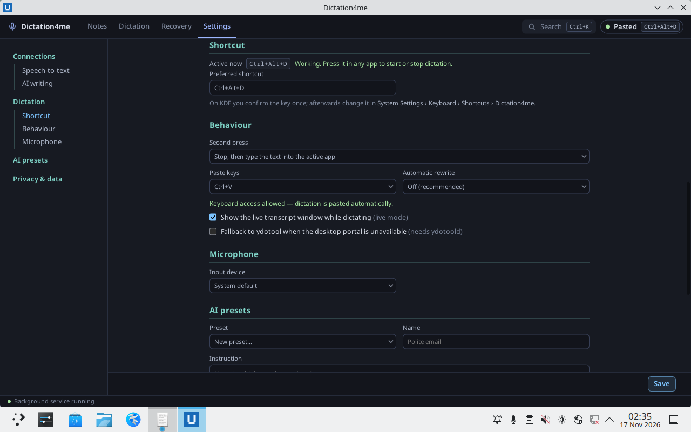

| Second press | Press 1 | Press 2 | Press 3 |
|---|---|---|---|
| **Stop, then type the text into the active app** (2 presses) | record | stop → text is typed where your cursor is | new dictation |
| **Stop, then copy to the clipboard** (2 presses) | record | stop → text is on the clipboard, you paste | new dictation |
| **Review first** (3 presses) | record | stop → text is ready | copy |

For **typing into the active app** on KDE Wayland, click **Allow automatic pasting…** once and press **Approve** in KDE's *Remote Control* dialog with *Allow restoring on future sessions* ticked. This is the desktop's own permission system; Dictation4me installs nothing privileged. Choose **Ctrl+Shift+V** as paste keys if you mostly dictate into terminals.

## 4. Dictating into any app

1. Put the cursor where the text should go (an email, a chat box, an editor).
2. Press **Ctrl+Alt+D** and speak. The tray icon and the dictation chip in the notebook turn red. In live mode a small window shows your words.
3. Press **Ctrl+Alt+D** again. The live window closes, your text is transcribed and typed into the app.

| Live window while you speak | Result typed into the app |
|---|---|
| 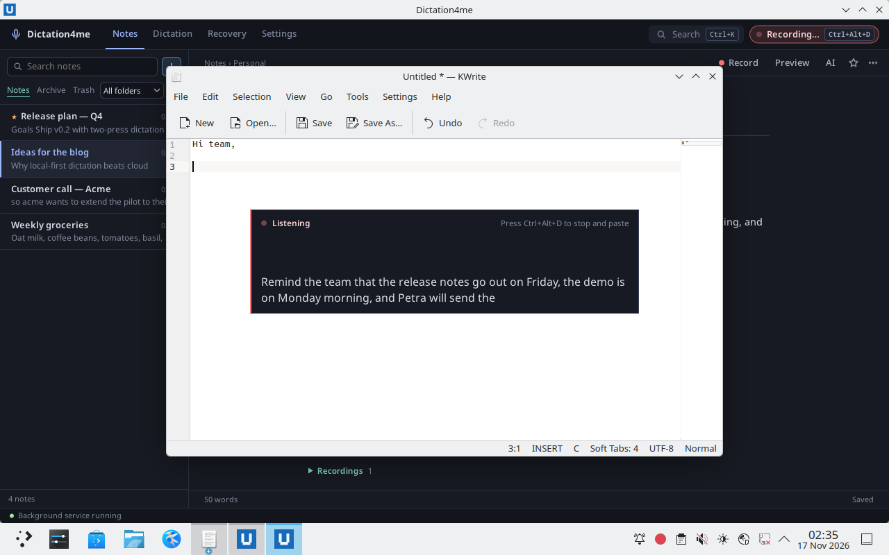 | 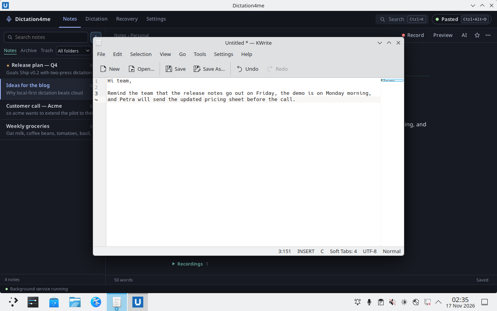 |

Good to know:

- The text always goes to the clipboard first. If automatic pasting is unavailable, you get a notification that says why, and the text is still on the clipboard.
- While text is being transcribed, extra presses are ignored. Nothing is queued or pasted twice.
- The live window takes keyboard focus while you speak (KDE gives new windows focus). It closes before pasting, so the text lands in your app.
- If nothing was heard, you get "No speech detected". The audio is kept in Recovery and the next press simply records again.

### Dictation tab

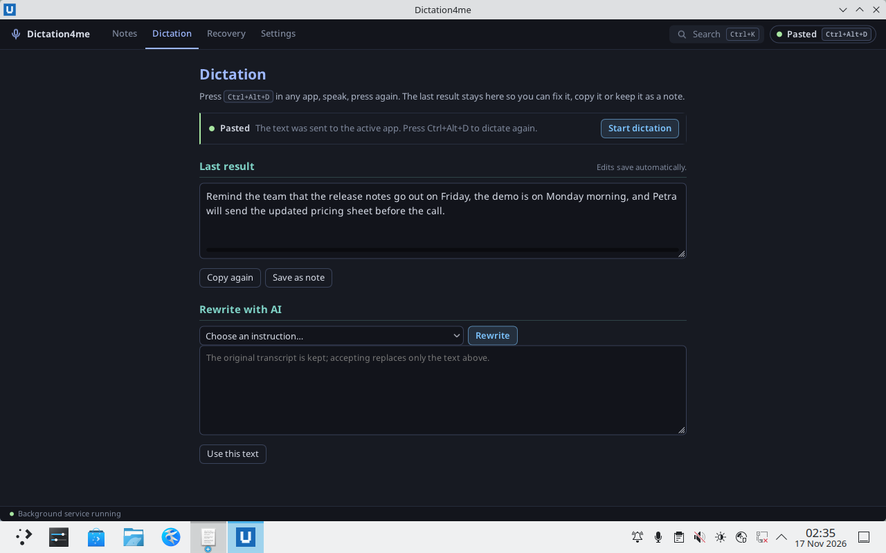

The **Dictation** tab shows the current state and the last result. You can edit it, **Copy again**, **Save as note**, or **Rewrite with AI** (the original transcript is kept). The button in the status line does the same as the shortcut, and so does the **dictation chip** in the top-right corner of every tab.

### Tray icon

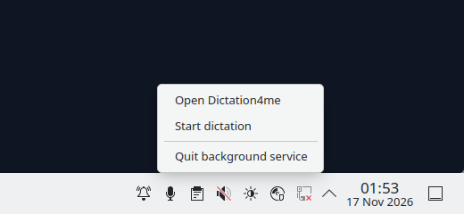

The microphone in the system tray shows the state (red dot while recording, a warning sign if something needs attention). Click it to open the notebook; right-click for *Start/Stop dictation* and *Quit background service*.

## 5. The notebook

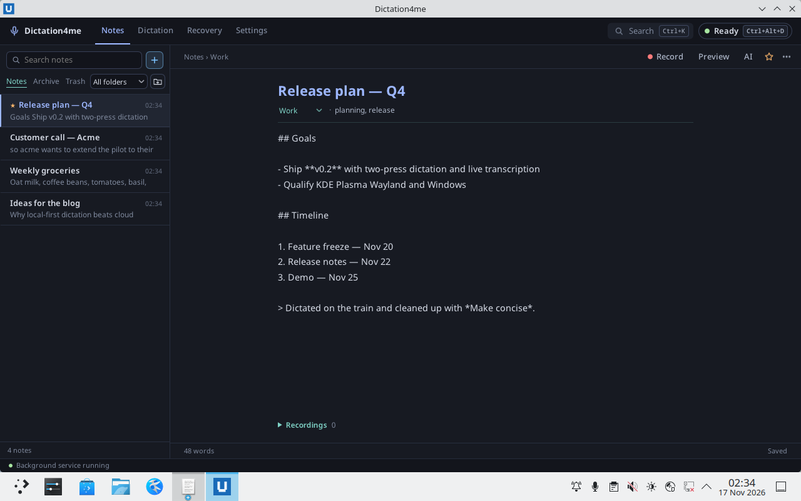

- **Notes list:** search (Ctrl+K or the search pill in the top bar), switch between *Notes*, *Archive* and *Trash*, filter by folder, create folders with the folder button. Pinned notes show a star.
- **Editor:** title, then the folder · tags line, then Markdown text. Changes save automatically ("Saved" in the bottom right). **Preview** renders the Markdown:

  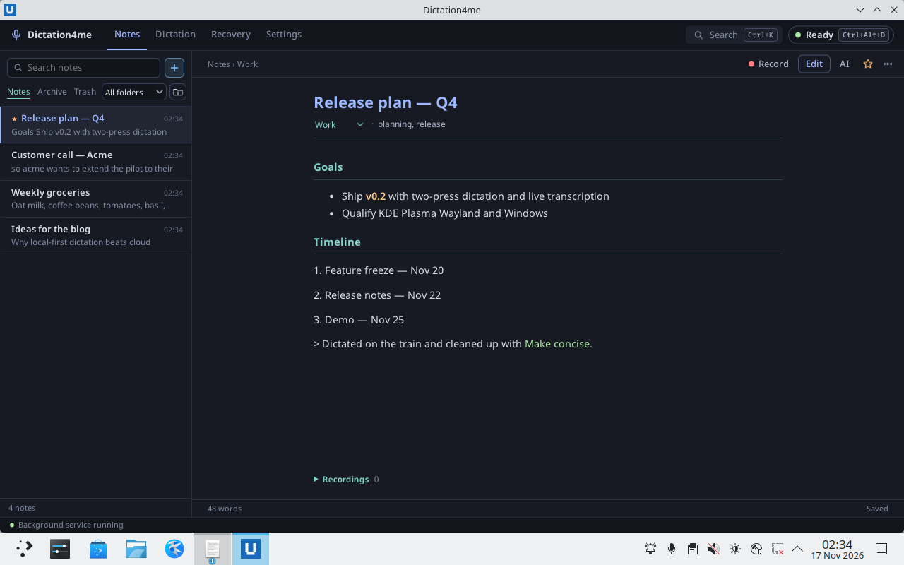

- **More menu (⋯):** copy the note text, *Save version* (Ctrl+S), *Archive*, *Move to Trash*. Notes in Trash can be restored or deleted forever (with confirmation).

### Voice notes

Press **Record** in a note and speak. In live mode your words appear under the note as you talk; press **Stop** and the text is added to the note.

| While recording | After Stop |
|---|---|
| 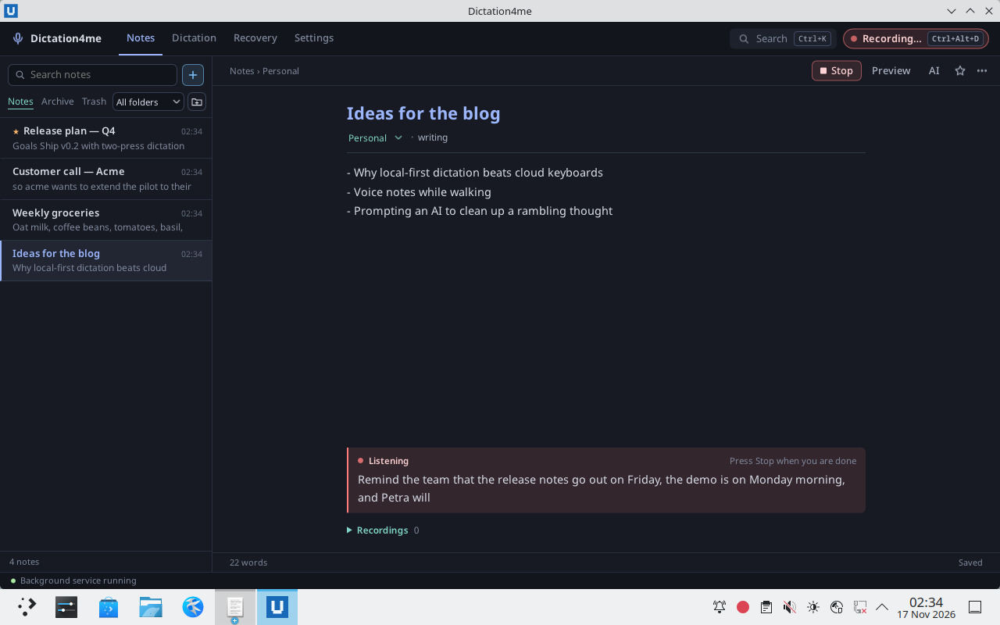 | 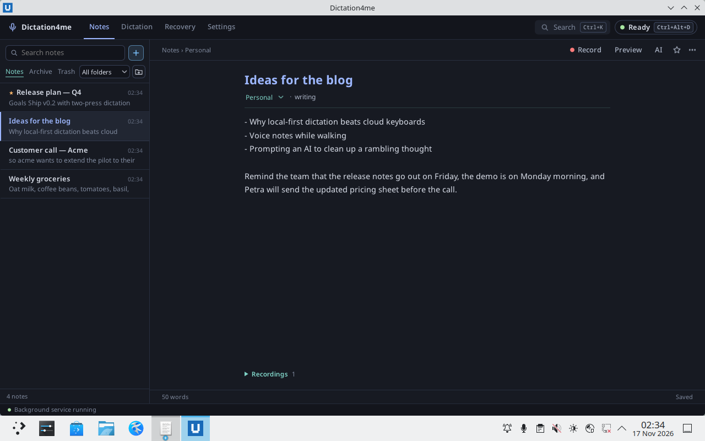 |

If you edit the note while recording, your typing wins: the transcript is not inserted automatically, but is listed under **Recordings** with an *Add text to note* button.

### AI rewrite, versions and history

Click **AI** in the note toolbar, choose an instruction (e.g. *Meeting summary*) and press **Run**. You get a **proposal**; your note is unchanged until you choose:

- **Replace note:** the proposal becomes the note; the previous text is kept as a version.
- **Keep as version:** stored in the note's history only.
- **New note:** creates a separate note.
- **Discard.**

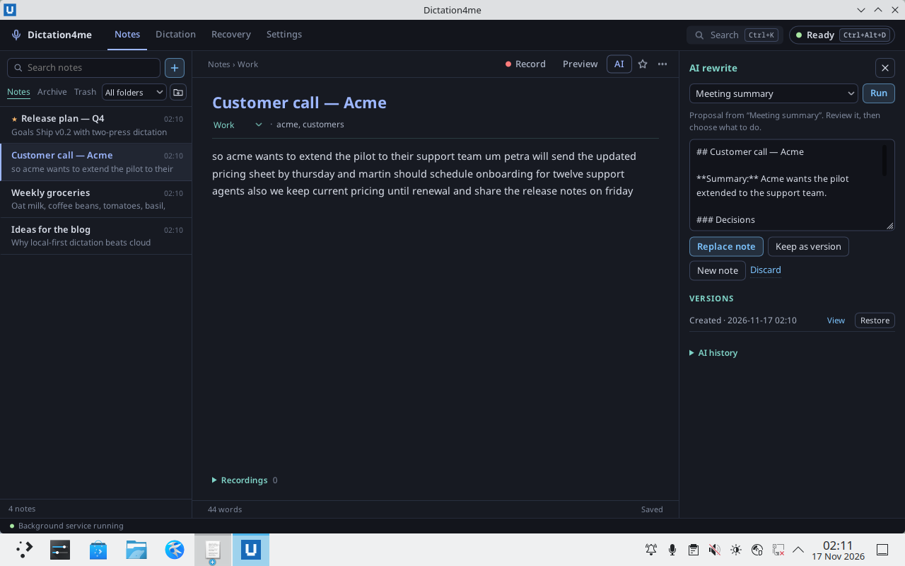

**Versions** lists every saved state (created, dictation added, AI rewrite applied, restored, saved manually). *View* shows an old version and *Restore* brings it back as a new version, so nothing is ever overwritten.

### AI presets (Settings › AI presets)

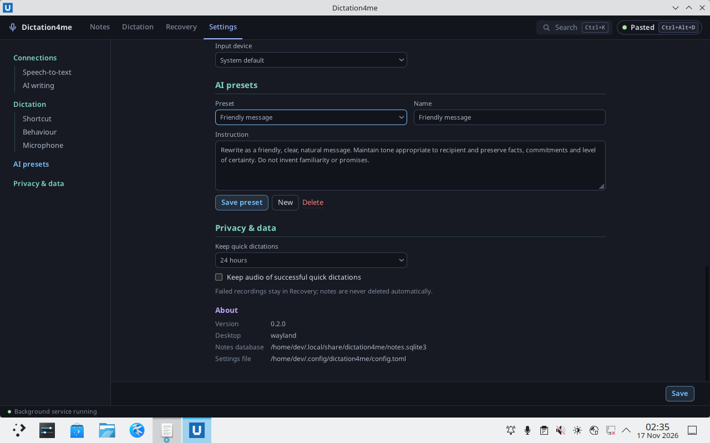

Eight built-in instructions (Clean transcript, Make concise, Friendly message, Professional message, Architecture decision, Extract tasks, Coding agent prompt, Meeting summary) can be edited, and you can add your own.

## 6. Recovery

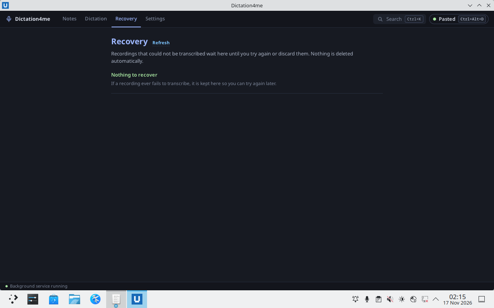

Recordings that could not be transcribed (server down, wrong key, no speech) are kept with the reason and a **How to fix** hint. Use **Try again** once the problem is fixed, or **Discard**. Nothing here is deleted automatically.

## 7. Settings reference

Settings live in `~/.config/dictation4me/config.toml` (Windows: `%APPDATA%\Dictation4me\config.toml`). Use the Settings screen; the file is validated, and an invalid value is rejected with a message instead of being saved.

| Setting (file key) | Screen | Default | Meaning |
|---|---|---|---|
| `stt.base_url` | Connections | `http://127.0.0.1:4000/v1` | Speech-to-text server |
| `stt.engine` | Connections | `batch` | `batch` (after you stop) or `realtime` (live) |
| `stt.model` | Connections | — | Batch model, also the live-mode fallback |
| `stt.realtime_model` | Connections | — | Realtime model (live mode) |
| `stt.key_source` / `key_reference` | Connections | `none` | `none`, `environment` (+ variable name) or `keyring` |
| `stt.path` | Connections › Advanced | `/audio/transcriptions` | Endpoint path |
| `stt.request_profile` | Connections › Advanced | `minimal` | `minimal`, `openai-modern`, `legacy-language` |
| `stt.realtime_path` | Connections › Advanced | `/realtime` | Realtime websocket path (`ws(s)://…/v1/realtime?model=`) |
| `ai.base_url`, `ai.model`, keys | Connections | — | AI writing server |
| `privacy.remote_provider_approved` | Connections | `false` | Required for internet servers |
| `quick.shortcut` | Dictation | `Ctrl+Alt+D` | Preferred shortcut (KDE keeps its own binding afterwards) |
| `quick.auto_deliver` + `quick.output_mode` | Dictation › Shortcut behaviour | review | `true` + `attempt-paste` = type into app; `true` + `clipboard` = copy; `false` = review |
| `quick.paste_shortcut` | Dictation | `Ctrl+V` | `Ctrl+V`, `Ctrl+Shift+V`, `Shift+Insert` |
| `quick.live_window` | Dictation | `true` | Show the live window in live mode |
| `quick.paste_to_current_focus_unsafe_wayland` | Dictation | `false` | Fallback to `ydotool` if the portal is unavailable |
| `audio.device` | Dictation | `default` | Microphone (`default` follows your desktop) |
| `ai.automatic_quick_preset_id` | Dictation | off | Rewrite every quick dictation automatically |
| `quick.quick_text_retention_hours` | Privacy & data | `24` | Keep quick results 0 / 24 / 168 hours or forever (`-1`) |
| `quick.record_audio_success_retention` | Privacy & data | delete | Keep audio of successful quick dictations |
| `audio.max_seconds` | file only | `300` | Maximum recording length |

Set `DICTATION4ME_HOME=/some/folder` to run a completely separate profile (used for tests and restores).

## 8. Command line

```text
dictation4me gui                      open the notebook
dictation4me quick-review             open the notebook on Quick dictation
dictation4me toggle                   same as pressing the shortcut
dictation4me cancel                   cancel the current recording (audio is kept)
dictation4me copy-last                copy the last result again
dictation4me paste-last               deliver the last result again (may duplicate text)
dictation4me service start|stop|restart|status
dictation4me doctor [--json]          check everything; lists problems with fixes
dictation4me devices                  list microphones
dictation4me config show|validate
dictation4me test microphone [--seconds N]
dictation4me test stt --file sample.wav
dictation4me test ai
dictation4me test clipboard
dictation4me test paste --i-understand  sends real paste keys after 3 s
dictation4me recover list|retry|salvage|delete [ID]
dictation4me backup --output backup.zip [--no-with-audio]
dictation4me export --output notes.zip [--with-audio]
dictation4me restore --input backup.zip --destination ./new-profile
dictation4me uninstall [--purge --confirm-purge]
```

Every error prints a **How to fix** line, for example:

```text
ERROR [SERVICE_UNAVAILABLE]: The Dictation4me resident service is not reachable
  How to fix: Start it with 'dictation4me service start'; details in ~/.local/state/dictation4me/service.log
```

If the desktop portal is unavailable, bind a custom KDE shortcut to `dictation4me toggle`; it behaves exactly like the built-in one.

## 9. Privacy and your data

| What | Where (Linux) |
|---|---|
| Settings | `~/.config/dictation4me/` |
| Notes database, recordings | `~/.local/share/dictation4me/` |
| Logs, paste permission token | `~/.local/state/dictation4me/` |
| API keys | OS keyring or your environment, never in files written by the app |

- Audio and text are sent **only** to the servers you configure, and only when you dictate, test, or ask for an AI rewrite (or enable automatic rewrite).
- Logs and notifications never contain your text or keys.
- Backups (`dictation4me backup`) are unencrypted ZIP files; store them safely. `restore` always writes into a new, empty folder.
- Original transcripts are kept unchanged; edits and AI results create new versions.

## 10. Troubleshooting

Start with:

```sh
dictation4me doctor
```

It lists each problem with a fix. Logs are in `~/.local/state/dictation4me/service.log` (service) and `gui.log` (notebook).

| Symptom | Fix |
|---|---|
| "PortAudio is unavailable" | `sudo apt install libportaudio2`, then `dictation4me service restart` |
| "Cannot open the microphone" / recordings too short | `sudo apt install pipewire-alsa`; pick the microphone in Settings › Dictation; check it is not muted |
| Shortcut does nothing | Settings › Dictation shows the active key and status. Run `dictation4me init` once (desktop entry), then `dictation4me service restart`. Check for conflicts in System Settings › Shortcuts (e.g. Meta+L = lock screen). |
| Shortcut stops working after closing the window | Update: the service now runs as its own systemd user unit and survives the window. Check `dictation4me service status`. |
| Text is copied but not typed | Settings › Dictation › *Allow automatic pasting…* and approve the KDE dialog. In terminals use *Ctrl+Shift+V* as paste keys. |
| "Key not available to the background service" | Use *Move key to keyring* (Settings › Connections), or paste the key there. `~/.bashrc` variables are not visible at login. |
| "Server returned HTTP 401/403" | Wrong or missing API key for that server |
| "HTTP 404" | Wrong model name or endpoint path (Settings › Connections › Advanced) |
| "Cannot connect to the server" | Server URL, VPN, firewall; try `curl <url>/models` |
| "Live transcription unavailable" | Check the realtime model and that the server supports `/v1/realtime`; dictation continues with the normal model |
| "Plain HTTP is permitted only for a local/private endpoint" | Use `https://`, or a home-network host name / private IP |
| "No speech detected" | Microphone level or wrong input device; the audio is in Recovery |
| Notebook shows "Background service not running" | `dictation4me service start`, or reopen the app |

## 11. Updating and uninstalling

```sh
uv tool upgrade dictation4me
dictation4me service restart

dictation4me uninstall        # removes launchers and autostart, keeps notes
uv tool uninstall dictation4me
```

`dictation4me uninstall --purge --confirm-purge` also deletes all notes, recordings and settings.

## Appendix: LiteLLM + vLLM server example

A single LiteLLM gateway can serve all three models Dictation4me uses:

```yaml
model_list:
  # Live dictation: Voxtral realtime on vLLM, used at ws://<gateway>/v1/realtime?model=asr-realtime
  - model_name: asr-realtime
    litellm_params:
      model: openai/asr-realtime          # openai/ prefix so LiteLLM's realtime handler is used
      api_base: http://stt-realtime:8000/v1
    model_info:
      mode: realtime
  # Batch transcription (also the live-mode fallback)
  - model_name: whisper-1
    litellm_params:
      model: openai/whisper-1
      api_base: http://parakeet-gateway:8080/v1
  # AI rewrite
  - model_name: brain-direct
    litellm_params:
      model: openai/your-chat-model
      api_base: http://llm:8000/v1
```

vLLM realtime server: `vllm serve mistralai/Voxtral-Mini-4B-Realtime-2602 --served-model-name asr-realtime --tokenizer-mode mistral`.

Dictation4me settings for this gateway:

```text
Speech-to-text  URL http://gateway:4000/v1   mode Live   model whisper-1   realtime model asr-realtime
AI writing      URL http://gateway:4000/v1   model brain-direct
API key         Environment variable LITELLM_API_KEY, or paste it (System keyring)
```
