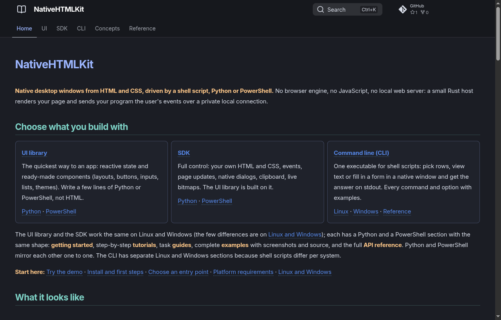
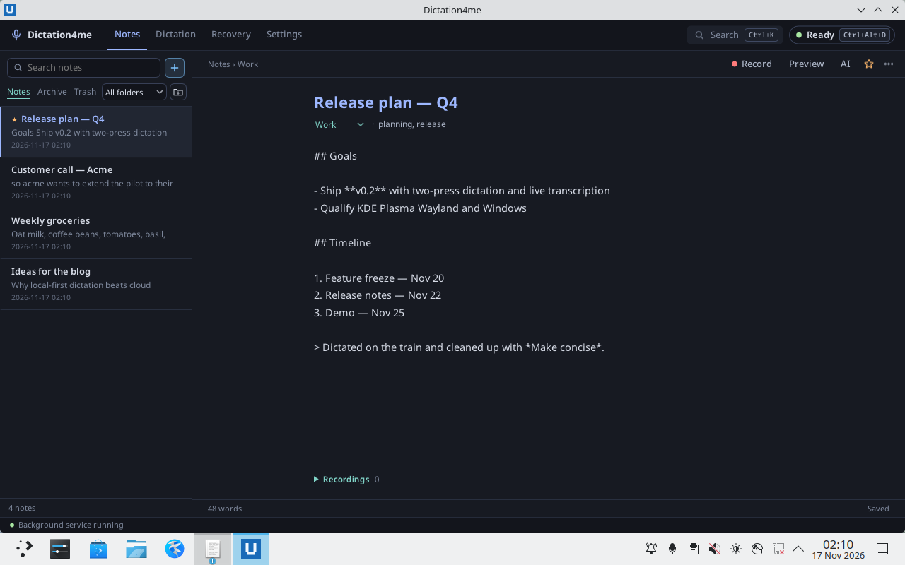
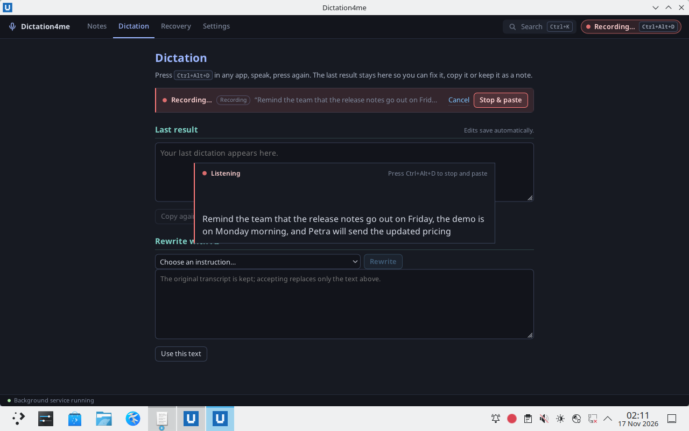
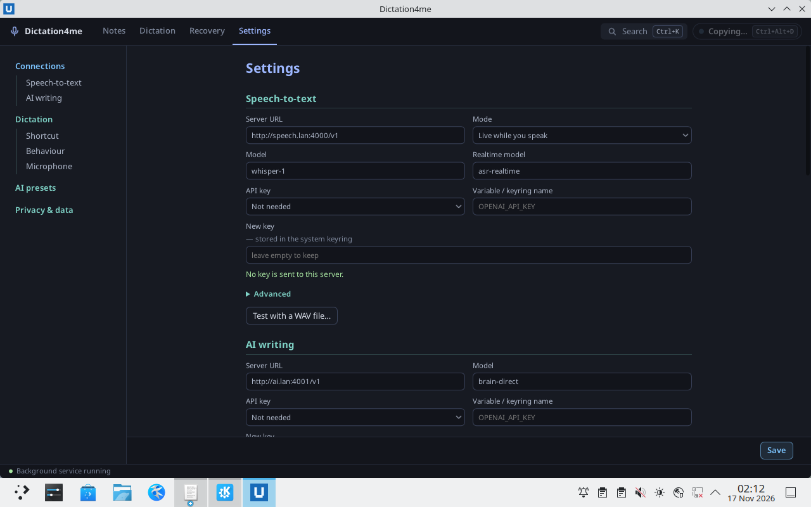
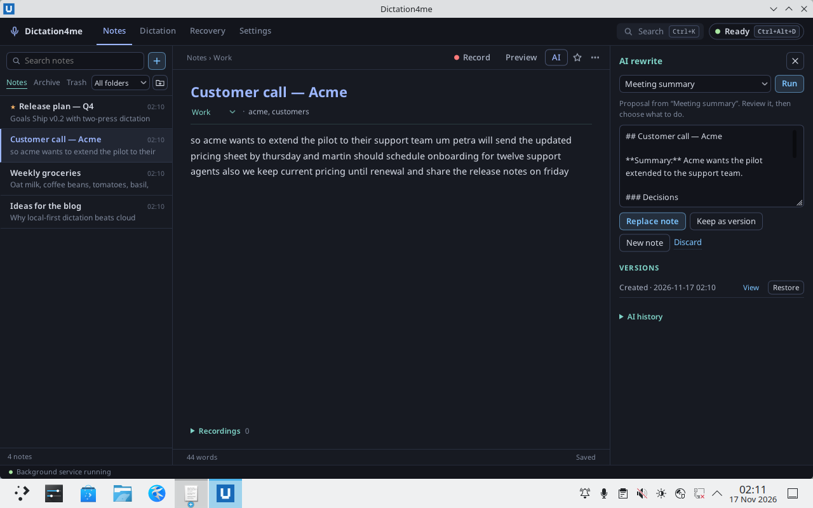
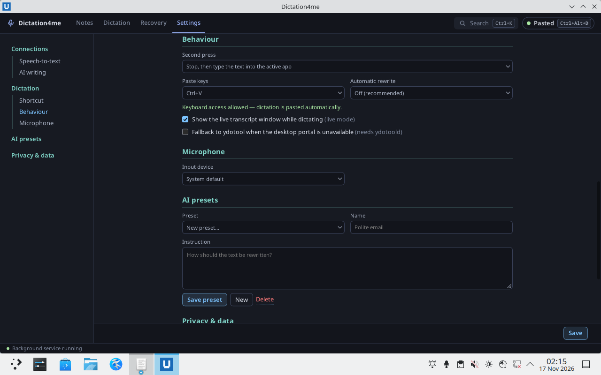

# UI redesign (branch `ui/sdk-redesign`) — for review

A flatter, more compact notebook modelled on the [NativeHTMLKit documentation site](https://nativehtmlkit.github.io/). It is built directly on the NativeHTMLKit Python SDK, with hand-written HTML/CSS and Python callbacks: no UI library, no JavaScript. All functionality of 0.2.0 is kept; only the layout and visual design changed.

| Reference: nativehtmlkit.github.io | Redesign |
|---|---|
|  |  |

## What was taken from the docs site

- **Neutral near-black surfaces** (`#171a22`) instead of slate blue; soft off-white text.
- **Colour-coded structure:** blue page and note titles, teal section headings with a hairline rule, amber for emphasis and hover, dotted-underline links.
- **Top tab bar with an underlined active tab**, plus a `Ctrl+K` search pill.
- **Left tree with teal section titles and thin guide lines** (used for Settings).
- **Hairlines instead of boxes.**

What was deliberately *not* copied: the large padded cards. Remaining framed elements use 8–12 px padding, controls are 26–28 px high and body text is 13 px.

## What changed

| Area | 0.2.0 | Redesign |
|---|---|---|
| Navigation | 236 px left sidebar with a large status card | 44 px top bar: tabs, search pill, **dictation chip** (state dot + shortcut; click to start/stop) |
| Note list | Card-like entries, three lines each | Dense rows: title + time on one line, one-line excerpt, blue edge for the selected note |
| Note editor | Toolbar with labelled buttons | Document column (720 px) with blue title, teal folder · tags line, quiet toolbar |
| AI | Drawer with boxed sections | Right rail separated by a hairline |
| Dictation page | Big hero card | Article page: one status line with the action button, "Last result" and "Rewrite with AI" sections |
| Settings | Four tabs of large cards | **One page like a docs article** with a left tree that jumps to sections; two-column compact fields; save bar |
| Recovery | Dashed empty-state box | Rows separated by hairlines; one-line empty state |
| Live window | Slate with thick red edge | Same palette as the notebook, thinner accent |

| Dictation (recording) | Settings |
|---|---|
|  |  |
| **AI rail** | **Settings — Behaviour** |
|  |  |

## Fixes found during this review (also apply to 0.2.0)

- The status said **"Pasted"** even when automatic pasting failed. The service now reports the real delivery outcome, and the UI shows "Copied — paste with Ctrl+V" when pasting didn't happen.
- Paste-permission errors repeated "Fix:" twice in notifications.
- While KDE's first-time "Remote Control" dialog is open (it can appear behind the window), the status now says so instead of only "Copying…".

## Verified

On KDE Plasma 6.6 Wayland (linuxDEV) with real pointer and keyboard input: notes, list rows, More menu, AI rail with a real proposal, live dictation from the top-bar chip with the live window, the first-time permission dialog (deny and approve), text pasted into KWrite, Settings tree navigation, Recovery. Headless render at 1280 × 800 reports no unsupported CSS. 107 automated tests pass.
